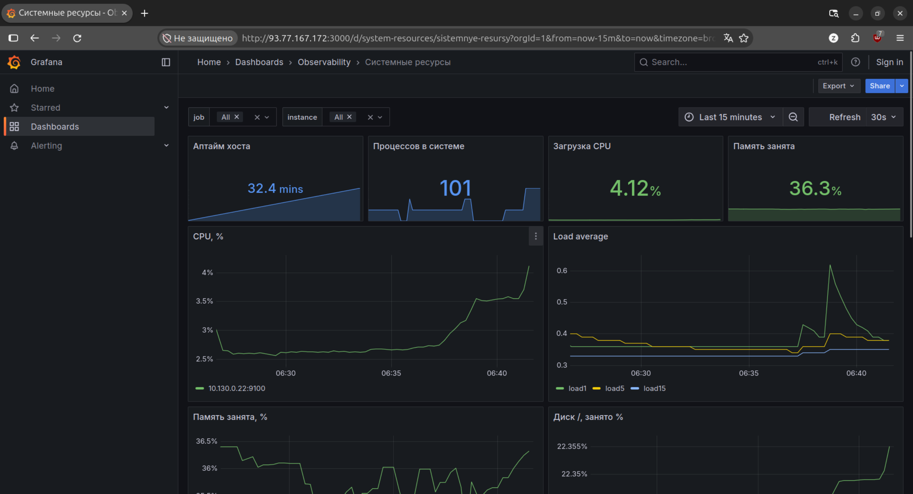
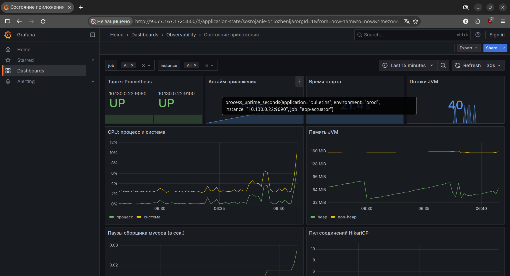
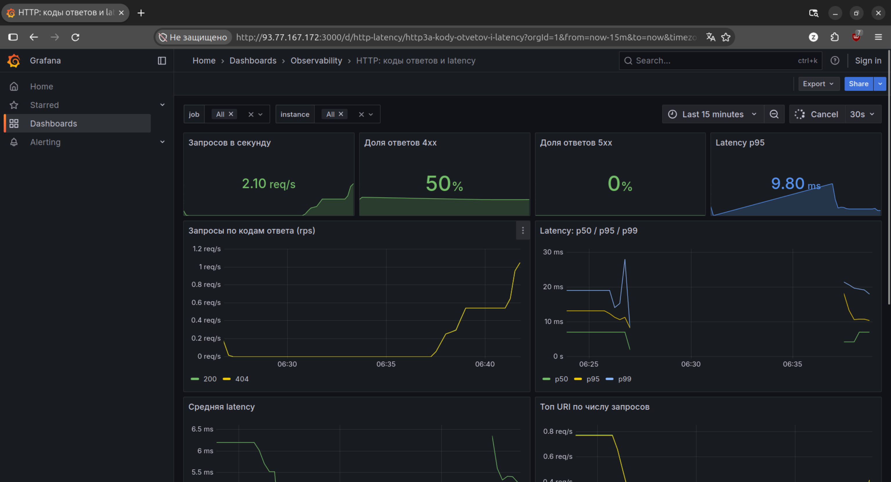
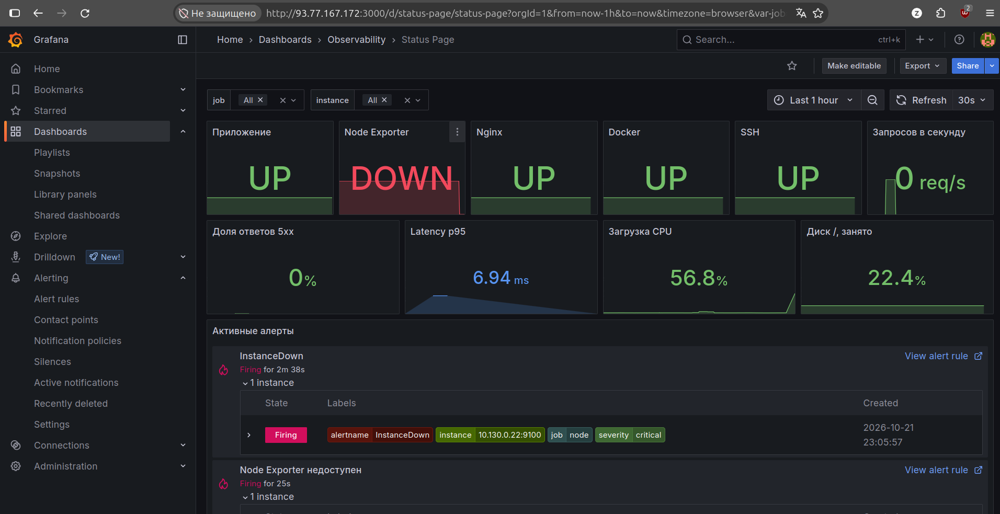
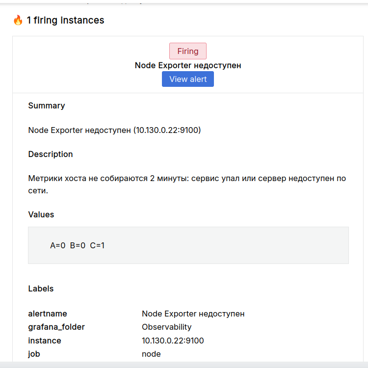
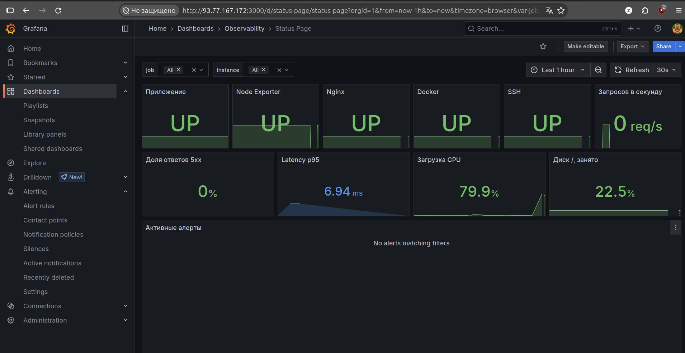

# Project DevOps Deploy — Observability


Сервис «Доска объявлений» (Spring Boot + PostgreSQL) и инфраструктура вокруг него в Yandex Cloud, описанная кодом (Ansible + Makefile).

## Ссылки

- Приложение: http://178.154.234.125/
- Swagger UI: http://178.154.234.125/swagger-ui/index.html
- Форк приложения: https://github.com/n0d33p/project-devops-deploy
- Docker-образ: `nxdeep/project-devops-deploy` (Docker Hub)

## Инфраструктура (Yandex Cloud)

| Ресурс | Параметры |
|---|---|
| App VM `app-vm-d` | Ubuntu 24.04, 2 vCPU (50%), 2 ГБ RAM, 15 ГБ, зона `ru-central1-d`, статический внешний IP |
| Managed PostgreSQL `bulletins-db-d` | 1 хост `b2.medium` (Intel Cascade Lake, 50% vCPU), network-hdd 10 ГБ, без публичного доступа |
| Object Storage | бакет `bulletins-obs-p4-zayats` |
| Сеть | `default`, подсеть `default-ru-central1-d` |

### Создание ресурсов

```bash
# ВМ (cloud-init.yaml с публичным SSH-ключом, см. ниже)
yc compute instance create --name app-vm-d --zone ru-central1-d \
  --platform standard-v3 --cores 2 --core-fraction 50 --memory 2 \
  --create-boot-disk size=15,image-folder-id=standard-images,image-family=ubuntu-2404-lts \
  --network-interface subnet-name=default-ru-central1-d,nat-ip-version=ipv4 \
  --metadata-from-file user-data=cloud-init.yaml

# Кластер PostgreSQL (пароль сгенерировать и положить в Ansible Vault)
yc managed-postgresql cluster create --name bulletins-db-d --environment production \
  --network-name default \
  --host zone-id=ru-central1-d,subnet-id=fl83l4fqsqtmtcn31070 \
  --resource-preset b2.medium --disk-type network-hdd --disk-size 10 \
  --user name=bulletins,password=<пароль> --database name=bulletins,owner=bulletins
```

Пример `cloud-init.yaml` (подставьте свой публичный ключ):

```yaml
#cloud-config
users:
  - name: wh0am1
    groups: sudo
    shell: /bin/bash
    sudo: 'ALL=(ALL) NOPASSWD:ALL'
    ssh_authorized_keys:
      - ssh-ed25519 AAAA... комментарий
```

Бакет создаёт Ansible-роль `storage`.

## Ansible

Всё лежит в каталоге `ansible/`:

- `playbook.yml` — подготовка сервера и деплой, `update.yml` — обновление версии образа;
- `roles/common` (Docker, пользователь, UFW), `roles/deploy` (compose, `.env`, проверка health), `roles/nginx` (reverse proxy), `roles/storage` (бакет), `roles/update`;
- `group_vars/all/main.yml` — несекретные переменные, `group_vars/*/vault.yml` — секреты в Ansible Vault.

Приложение запускается с профилем `prod` и подключается к PostgreSQL по TLS (`sslmode=require`). Actuator в контейнере слушает только 127.0.0.1:9090, наружу метрики отдаёт Nginx (см. раздел «Метрики»)

## Команды

```bash
make bootstrap                    # роли и коллекции Ansible
make deploy                       # подготовка сервера + деплой (спросит пароль Vault)
make update IMAGE_TAG=<тег>       # обновить версию
make rollback IMAGE_TAG=<тег>     # откат на предыдущий тег
make promtool                     # проверка правил алертинга (promtool в Docker)
```

Требования: Ansible 2.15+, `python3-boto3` (для создания бакета), доступ по SSH к `app-vm-d` и `monitoring-vm-e`, пароль от Vault.

## Проверка

```bash
curl -i http://178.154.234.125/api/bulletins
ssh wh0am1@178.154.234.125 'curl -s localhost:9090/actuator/health'
ssh wh0am1@178.154.234.125 'docker logs bulletin-board-app-1'
```
## Метрики (Node Exporter и Actuator)

Роль `ansible/roles/node_exporter` ставит Node Exporter как systemd-сервис (пользователь `node_exporter`, бинарник в `/usr/local/bin`, автозапуск и перезапуск при изменении бинарника или юнита). Метрики приложения отдаёт Spring Actuator, наружу их проксирует Nginx.

### Endpoints

| Назначение | Адрес | Защита |
|---|---|---|
| Метрики хоста | `http://<app-private-ip>:9100/metrics` | UFW: только сеть мониторинга |
| Health приложения | `http://<app-private-ip>:9090/actuator/health` | Nginx: `allow/deny` + basic-auth, UFW |
| Метрики приложения | `http://<app-private-ip>:9090/actuator/prometheus` | то же |
| Сайт и API | `http://178.154.234.125/` | публично |

Здесь `<app-private-ip>` — приватный адрес App VM (`10.130.0.22`). Снаружи порты 9100 и 9090 недоступны.

### Параметры доступа

| Параметр | Значение | Где задан |
|---|---|---|
| `node_exporter_version` | версия Node Exporter | `group_vars/all/main.yml` |
| `node_exporter_port` | `9100` | `group_vars/all/main.yml` |
| `app_management_port` | `9090` | `group_vars/all/main.yml` |
| `monitoring_allowed_cidr` | `10.131.0.18/32` (приватный адрес Monitoring VM) | `group_vars/all/main.yml` |
| `metrics_user` | `prometheus` | `group_vars/all/main.yml` |
| `vault_metrics_password` | пароль basic-auth | Ansible Vault |

Порт контейнера `9090` привязан к `127.0.0.1` намеренно: опубликованные Docker-порты обходят UFW. Наружу метрики выходят только через Nginx, который слушает приватный IP и пускает запросы лишь из `monitoring_allowed_cidr` с паролем.

### Обязательные метрики

Хост (Node Exporter):

| Область | Метрика | Что показывает |
|---|---|---|
| CPU | `node_load1`, `node_load5`, `node_load15` | средняя нагрузка за 1/5/15 минут |
| CPU | `node_cpu_seconds_total` | время CPU по режимам |
| Память | `node_memory_MemTotal_bytes`, `node_memory_MemAvailable_bytes` | всего и доступно памяти |
| Память | `node_memory_SwapFree_bytes` | свободный swap |
| Диски | `node_filesystem_size_bytes`, `node_filesystem_avail_bytes` | размер и свободное место |
| Диски | `node_disk_io_time_seconds_total` | загрузка дискового ввода-вывода |
| Сеть | `node_network_receive_bytes_total`, `node_network_transmit_bytes_total` | входящий и исходящий трафик |
| Процессы | `node_procs_running`, `node_processes_pids` | запущенные процессы и их число |
| Сервисы | `node_systemd_unit_state{name=...}` | состояние `docker`, `nginx`, `ssh`, `node_exporter` |

Приложение (Actuator/Micrometer):

| Метрика | Что показывает |
|---|---|
| `process_uptime_seconds` | время работы приложения |
| `application_ready_time_seconds` | время старта до готовности |
| `process_cpu_usage`, `system_cpu_usage` | загрузка CPU процессом и системой |
| `jvm_memory_used_bytes`, `jvm_memory_max_bytes` | память JVM |
| `jvm_threads_live_threads` | число живых потоков |
| `jvm_gc_pause_seconds_count` | паузы сборщика мусора |
| `http_server_requests_seconds_count`, `http_server_requests_seconds_sum` | запросы по меткам `uri`, `status`, `method`, `outcome` |
| `hikaricp_connections_active`, `hikaricp_connections_max` | пул соединений с PostgreSQL |

Коллекторы `systemd` и `processes` в Node Exporter выключены по умолчанию и включены флагами в systemd-юните.

### Проверка

На App VM:

```bash
systemctl status node_exporter --no-pager
curl -s http://10.130.0.22:9100/metrics | grep -E '^node_load1 '
curl -i http://10.130.0.22:9090/actuator/health            # 401 без пароля
curl -s -u prometheus http://10.130.0.22:9090/actuator/health
curl -s -u prometheus http://10.130.0.22:9090/actuator/prometheus | head
```

С ноутбука (должен быть таймаут, порты закрыты):

```bash
curl --max-time 5 http://178.154.234.125:9100/metrics
curl --max-time 5 http://178.154.234.125:9090/actuator/health
```

### Логи Nginx

Access-лог `/var/log/nginx/access.log` пишется в JSON (поля: `time`, `remote_addr`, `x_forwarded_for`, `host`, `request_method`, `request_uri`, `status`, `body_bytes_sent`, `request_time`, `upstream_response_time`, `http_referer`, `http_user_agent`). Формат задан переменной `nginx_log_format` в роли `ansible/roles/nginx`. Error-лог остаётся текстовым: Nginx не поддерживает JSON-формат для `error_log`.

## Prometheus

Prometheus развёрнут Ansible-ролью `ansible/roles/monitoring` на отдельной ВМ `monitoring-vm-e` (группа `monitoring`, зона `ru-central1-e`, внешний IP `93.77.167.172`, приватный `10.131.0.18`). Из-за аварии зоны `ru-central1-b` в Yandex Cloud инфраструктура проекта развёрнута в зонах `d` и `e`.

- UI: http://93.77.167.172:9090/graph (список таргетов: http://93.77.167.172:9090/targets)
- Доступ: basic-auth, пользователь `reviewer`, пароль выдаётся проверяющему отдельно.

### Как устроено

- Контейнер Prometheus запускается через docker compose из `/opt/monitoring`, образ `prom/prometheus:v3.13.2`.
- Конфиг и правила лежат в каталоге `/opt/monitoring/prometheus/config` (bind mount, только чтение), данные TSDB в отдельном volume `prometheus_data`.
- Отдельная Docker-сеть `monitoring`, к ней позже подключатся Grafana и Loki.
- `prometheus.yml` генерируется из шаблона по списку `prometheus_scrape_jobs` в `ansible/group_vars/all/main.yml`. Чтобы добавить таргет, достаточно добавить элемент в этот список и выполнить `make deploy`.
- Правила алертинга: `ansible/roles/monitoring/files/alerts.yml` (`InstanceDown`, `NginxServiceDown`, `HighLoad`, `LowMemory`, `LowDiskSpace`). Проверка: `make promtool`.
- Секреты в Ansible Vault: `vault_prometheus_web_password_hash` (хэш пароля UI), `vault_metrics_password` (пароль для сбора метрик приложения).

### Таргеты

| Job | Адрес | Что собирает |
|---|---|---|
| `node` | `10.130.0.22:9100` | метрики хоста (Node Exporter) |
| `app-actuator` | `10.130.0.22:9090/actuator/prometheus` | метрики приложения через Nginx, basic-auth |

### Безопасность

- Security Group `monitoring-sg` разрешает входящий трафик только на порты 22 (SSH) и 9090 (Prometheus).
- Порт 9090 защищён basic-auth. Docker публикует порты в обход UFW, поэтому защита основана на Security Group и авторизации.
- На App VM порты 9100 и 9090 открыты только для приватного адреса Monitoring VM (UFW и `allow/deny` в Nginx).

### Проверка

```bash
curl -s -u reviewer http://93.77.167.172:9090/api/v1/targets | python3 -m json.tool | grep -E '"(job|health)"'
curl -s -u reviewer --data-urlencode 'query=up' http://93.77.167.172:9090/api/v1/query
```

Для обоих таргетов `up == 1`; то же видно в `/graph` по запросу `up`.

### Создание Monitoring VM

```bash
yc vpc security-group create --name monitoring-sg --network-name default \
  --rule "direction=ingress,port=22,protocol=tcp,v4-cidrs=[0.0.0.0/0]" \
  --rule "direction=ingress,port=9090,protocol=tcp,v4-cidrs=[0.0.0.0/0]" \
  --rule "direction=egress,from-port=0,to-port=65535,protocol=any,v4-cidrs=[0.0.0.0/0]"

yc compute instance create --name monitoring-vm-e --zone ru-central1-e --platform standard-v3 \
  --cores 2 --core-fraction 20 --memory 4 \
  --create-boot-disk size=10,image-folder-id=standard-images,image-family=ubuntu-2404-lts \
  --network-interface subnet-name=default-ru-central1-e,nat-ip-version=ipv4,security-group-ids=<ID monitoring-sg> \
  --metadata-from-file user-data=cloud-init.yaml
```

### Создание Monitoring VM

```bash
yc vpc security-group create --name monitoring-sg --network-name default \
  --rule "direction=ingress,port=22,protocol=tcp,v4-cidrs=[0.0.0.0/0]" \
  --rule "direction=ingress,port=9090,protocol=tcp,v4-cidrs=[0.0.0.0/0]" \
  --rule "direction=egress,from-port=0,to-port=65535,protocol=any,v4-cidrs=[0.0.0.0/0]"

yc compute instance create --name monitoring-vm-e --zone ru-central1-e --platform standard-v3 \
  --cores 2 --core-fraction 20 --memory 4 \
  --create-boot-disk size=10,image-folder-id=standard-images,image-family=ubuntu-2404-lts \
  --network-interface subnet-name=default-ru-central1-e,nat-ip-version=ipv4,security-group-ids=<ID monitoring-sg> \
  --metadata-from-file user-data=cloud-init.yaml
```

Адрес в `ansible/inventory.ini` (группа `monitoring`) и приватный адрес в `monitoring_allowed_cidr` нужно обновить после создания ВМ.

## Grafana

- URL: http://93.77.167.172:3000
- Администратор: `admin`, пароль хранится в Ansible Vault (`vault_grafana_admin_password`), в репозитории его нет.
- Анонимный просмотр включён (роль Viewer, переменная `grafana_anonymous_enabled`); менять дашборды может только администратор.
- Контейнер Grafana запускается в том же compose-проекте, что и Prometheus. Данные лежат в volume `grafana_data`, провижининг (источники данных и дашборды) в каталоге `/opt/monitoring/grafana` на сервере.
- Источники данных описаны в `ansible/roles/monitoring/templates/grafana-datasources.yml.j2` (Prometheus и Loki). Пароль для Prometheus берётся из переменной окружения контейнера, которую Ansible собирает из Vault.
- Дашборды лежат в `ansible/roles/monitoring/files/dashboards/` и генерируются скриптом `scripts/gen_dashboards.py`.

### Дашборды

| Дашборд | Что показывает |
|---|---|
| Системные ресурсы | CPU, load average, память, диск, сеть, процессы, статус systemd-сервисов |
| Состояние приложения | таргет, аптайм, CPU и память JVM, потоки, паузы GC, пул соединений |
| HTTP: коды ответов и latency | запросы по кодам, доли 4xx и 5xx, перцентили p50/p95/p99, latency по URI |

Во всех дашбордах работают переменные `$job` и `$instance`.





### Обновление дашбордов

```bash
make gen-dashboards   # пересобрать JSON из scripts/gen_dashboards.py
make dashboards       # выкатить их на сервер мониторинга
```

Дашборды провижинятся без права правки через интерфейс (`allowUiUpdates: false`), поэтому изменения вносятся в скрипт и выкатываются командами выше.

## Алертинг (Grafana Alerting)

### Канал уведомлений

Уведомления уходят письмом через SMTP Яндекс Почты (contact point `email-oncall`). Секреты лежат в Ansible Vault: `vault_smtp_user` (логин и адрес отправителя), `vault_smtp_password` (пароль приложения Яндекс ID), `vault_alert_recipient` (адрес получателя); в репозитории их нет. Контейнер Grafana получает их переменными окружения из `.env`, который собирает Ansible.

- Contact point и политика уведомлений: `ansible/roles/monitoring/files/grafana-alerting/contact-points.yml` (получатель берётся из переменной `$ALERT_EMAIL_TO`).
- Политика: алерты группируются по `alertname` и `service`, повторное напоминание каждые 4 часа.

Как заменить адрес получателя или пароль: изменить значение в Vault (`ansible-vault edit ansible/group_vars/servers/vault.yml`) и выполнить `make deploy`.

### Правила

Правила лежат в репозитории (`ansible/roles/monitoring/files/grafana-alerting/alert-rules.yml`) и генерируются скриптом `scripts/gen_alerts.py`. Посмотреть их: Grafana, меню Alerting, Alert rules (папка Observability).

| Правило | Условие | `for` | severity | service |
|---|---|---|---|---|
| Приложение недоступно | `up{job="app-actuator"} < 1` | 2m | critical | app |
| Node Exporter недоступен | `up{job="node"} < 1` | 2m | critical | host |
| Системный сервис остановлен | nginx или docker не `active` | 2m | critical | host |
| Метрики перестали поступать | `absent(node_load1)` или `absent(process_uptime_seconds)` | 5m | warning | monitoring |
| Много ответов 5xx | доля `status=~"5.."` из `http_server_requests_seconds_count` > 5% | 5m | critical | app |
| Высокая задержка ответов | p95 по `http_server_requests_seconds_bucket` > 1 с | 5m | warning | app |
| Высокая загрузка CPU | CPU > 85% | 10m | warning | host |
| Мало свободной памяти | занято > 90% | 10m | warning | host |
| Заканчивается место на диске | `/` заполнен > 85% | 5m | warning | host |

Параметр `for` защищает от алертов на кратковременные всплески. Для правил по трафику при отсутствии запросов состояние `OK`, а не авария.

### Status Page

Дашборд `Status Page` (папка Observability): состояние приложения и сервисов (зелёный UP, красный DOWN), ключевые показатели и список активных алертов.

### Как вызвать тестовый алерт

1. Остановить Node Exporter на App VM: `ssh wh0am1@178.154.234.125 'sudo systemctl stop node_exporter'`.
2. Через 3–5 минут правило «Node Exporter недоступен» перейдёт в Firing (Alerting, Alert rules), придёт письмо `[FIRING:1]`, на Status Page панель станет красной.
3. Вернуть: `ssh wh0am1@178.154.234.125 'sudo systemctl start node_exporter'`. Через пару минут придёт письмо `[RESOLVED]`.

Проверить сам канал без аварии: Alerting, Contact points, `email-oncall`, Test.





### Обновление правил

```bash
make gen-alerts       # пересобрать правила из scripts/gen_alerts.py
make gen-dashboards   # пересобрать дашборды и Status Page
make dashboards       # выкатить правила и дашборды на сервер мониторинга
```

> Примечание: Prometheus тоже вычисляет правила из `ansible/roles/monitoring/files/alerts.yml` (`InstanceDown` и другие), поэтому на Status Page рядом с правилами Grafana видны и они. Alertmanager в проекте не используется: письма отправляет только Grafana Alerting.
