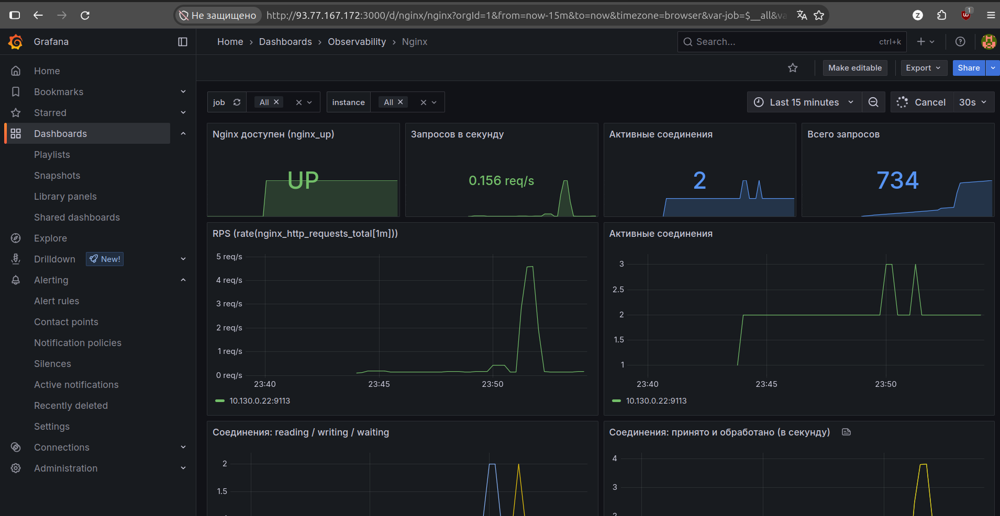
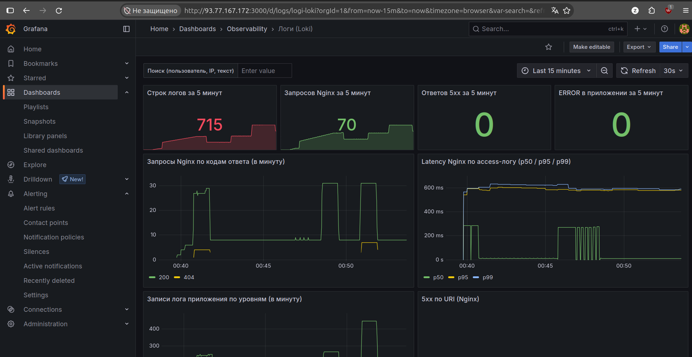
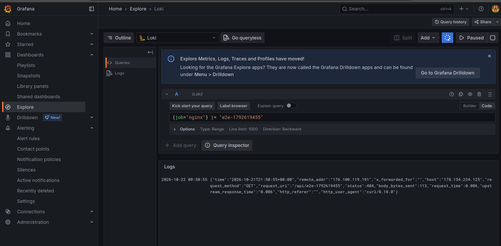
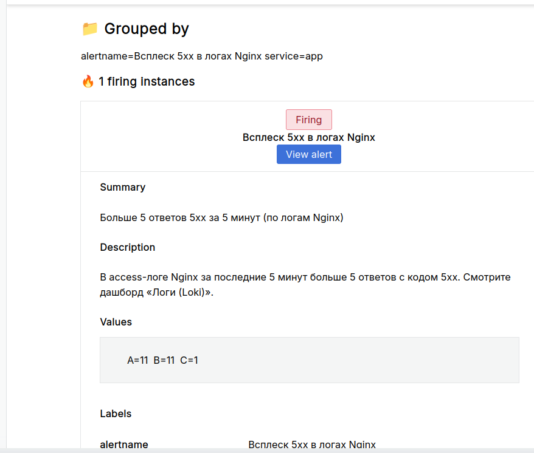
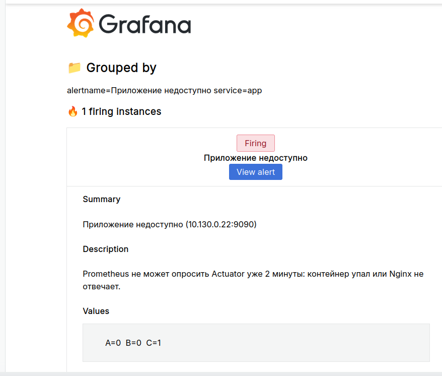
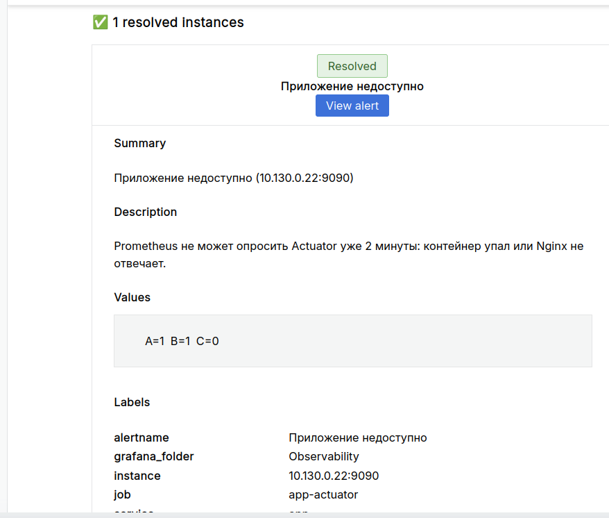

# Project DevOps Deploy — Observability


Сервис «Доска объявлений» (Spring Boot + PostgreSQL) и инфраструктура вокруг него в Yandex Cloud, описанная кодом (Ansible + Makefile).

## Ссылки

- Приложение: http://178.154.234.125/
- Swagger UI: http://178.154.234.125/swagger-ui/index.html
- Форк приложения: https://github.com/n0d33p/project-devops-deploy
- Docker-образ: `nxdeep/project-devops-deploy` (Docker Hub)
- Prometheus: http://93.77.167.172:9090/graph (basic-auth, см. раздел «Prometheus»)
- Grafana: http://93.77.167.172:3000 (дашборды в папке Observability: Status Page, Nginx, HTTP, состояние приложения, системные ресурсы)

## Справочник: адреса, порты, каналы оповещений

### Серверы

| Роль | Имя | Зона | Публичный IP | Приватный IP |
|---|---|---|---|---|
| App VM | `app-vm-d` (в inventory `app-vm`) | `ru-central1-d` | 178.154.234.125 | 10.130.0.22 |
| Monitoring VM | `monitoring-vm-e` (в inventory `monitoring-vm`) | `ru-central1-e` | 93.77.167.172 | 10.131.0.18 |
| Managed PostgreSQL | `bulletins-db-d` | `ru-central1-d` | нет | `db_host` в `main.yml`, порт 6432 |
| Object Storage | бакет `bulletins-obs-p4-zayats` | — | — | — |

Домен в проекте не используется: всё доступно по IP, TLS не настроен (порт 443 открыт в UFW про запас).

### URL

| Что | Адрес |
|---|---|
| Приложение и REST API | http://178.154.234.125/ и http://178.154.234.125/api/bulletins |
| Swagger UI | http://178.154.234.125/swagger-ui/index.html |
| Grafana | http://93.77.167.172:3000 (анонимный просмотр, администратор `admin`) |
| Дашборды (папка Observability) | Status Page, Системные ресурсы, Состояние приложения, HTTP: коды ответов и latency, Nginx, Логи (Loki) |
| Prometheus | http://93.77.167.172:9090/graph (basic-auth, пользователь `reviewer`) |

### Порты

| Сервер | Порт | Назначение | Кто имеет доступ |
|---|---|---|---|
| App VM | 22 | SSH | любые адреса (UFW OpenSSH) |
| App VM | 80 | Nginx: сайт и API | публично |
| App VM | 9100 | Node Exporter | только Monitoring VM (UFW) |
| App VM | 9113 | nginx-prometheus-exporter | только Monitoring VM (UFW) |
| App VM | 9090 (на приватном IP) | метрики приложения через Nginx | только Monitoring VM (UFW, `allow/deny` в Nginx, basic-auth) |
| App VM | 8080, 9090 (в контейнере), 8081, 9080 | приложение, Actuator, `stub_status`, Promtail | только `127.0.0.1` |
| Monitoring VM | 22 | SSH | любые адреса (Security Group) |
| Monitoring VM | 9090 | Prometheus | Security Group `monitoring-sg` и basic-auth |
| Monitoring VM | 3000 | Grafana | Security Group `monitoring-sg`; вход под `admin` или анонимный просмотр |
| Monitoring VM | 3100 | Loki | Security Group: только `10.130.0.22/32` (App VM) |

### Каналы оповещений

| Канал | Настройка |
|---|---|
| Почта (SMTP Яндекс Почты `smtp.yandex.ru:465`) | contact point `email-oncall`, адреса и пароль приложения в Vault (`vault_smtp_user`, `vault_smtp_password`, `vault_alert_recipient`) |

Telegram и ntfy в проекте не используются.

### Секреты (Ansible Vault)

Файлы: `ansible/group_vars/servers/vault.yml` (для обеих ВМ) и `ansible/group_vars/localnode/vault.yml` (ключи S3 для создания бакета с локальной машины). В репозитории только зашифрованные файлы.

| Переменная | Назначение |
|---|---|
| `user_password`, `vault_password_salt` | пароль и соль пользователя ОС на серверах |
| `vault_s3_access_key`, `vault_s3_secret_key` | статический ключ сервисного аккаунта Object Storage |
| `vault_db_password` | пароль пользователя PostgreSQL |
| `vault_metrics_password` | basic-auth для метрик приложения (Nginx и Prometheus) |
| `vault_prometheus_web_password_hash`, `vault_prometheus_web_password` | вход в Prometheus (хэш) и пароль для Grafana datasource |
| `vault_grafana_admin_password` | пароль `admin` в Grafana |
| `vault_smtp_user`, `vault_smtp_password`, `vault_alert_recipient` | почта для алертов |

## Развёртывание с нуля

Порядок для чистой машины и нового облачного каталога. Адреса из справочника выше нужно заменить на свои.

1. **Рабочая машина.** Linux с `git`, `make`, `ansible` (2.15+), `python3-boto3`, `docker` (для `promtool` и хэша пароля), `yc` (Yandex Cloud CLI), `openssl`, `nc`. Затем:
   ```bash
   git clone https://github.com/n0d33p/devops-engineer-from-scratch-project-318.git
   cd devops-engineer-from-scratch-project-318
   make bootstrap
   ```
2. **Приложение.** Форк `project-devops-deploy` (CI собирает Docker-образ и публикует его в Docker Hub); имя образа задано переменной `docker_image` в `ansible/group_vars/all/main.yml`.
3. **Yandex Cloud.** `yc init`, затем сервисный аккаунт с ролью `storage.editor` и статический ключ доступа (консоль или `yc iam ...`). Ключ пойдёт в Vault.
4. **SSH-ключ.** `ssh-keygen -t ed25519`; публичную часть подставить в `cloud-init.yaml` (пример в разделе «Инфраструктура»).
5. **Инфраструктура.** Выполнить команды из разделов «Создание ресурсов» и «Создание Monitoring VM»: App VM, кластер PostgreSQL, Security Group, Monitoring VM, правило для Loki (`yc vpc security-group update-rules ... port=3100 ... <приватный IP App VM>/32`), закрепление внешних адресов как статических.
6. **Адреса и параметры.** Обновить `ansible/inventory.ini` (группы `webservers` и `monitoring`) и в `ansible/group_vars/all/main.yml`: `app_private_ip`, `monitoring_private_ip`, `monitoring_allowed_cidr`, `db_host`, `s3_bucket_name` (имя уникально в рамках Yandex Cloud). Один раз зайти по SSH на каждую ВМ и принять отпечаток.
7. **Секреты.** Создать зашифрованные файлы и заполнить переменные из таблицы «Секреты»:
   ```bash
   ansible-vault create ansible/group_vars/servers/vault.yml
   ansible-vault create ansible/group_vars/localnode/vault.yml
   openssl rand -hex 16        # для паролей Grafana, метрик и базы
   docker run --rm httpd:2.4-alpine htpasswd -nbBC 10 reviewer '<пароль>' | cut -d: -f2   # хэш для Prometheus
   ```
   Пароль приложения почты создаётся в Яндекс ID (раздел безопасности).
8. **Развёртывание.** `make deploy` (спросит пароль Vault): создаёт бакет, настраивает обе ВМ, поднимает приложение, экспортёры, Nginx, Prometheus, Grafana, Loki и Promtail. Плейбуки идемпотентны: повторный запуск ничего не ломает.
9. **Проверка.** `make test`, `make smoke`, `make e2e-logs`, затем ручной чек-лист ниже.

Если ВМ пересоздана или адрес сменился: обновить адреса (шаг 6), принять новые отпечатки SSH и выполнить `make deploy`.

## Проверки

| Команда | Что проверяет |
|---|---|
| `make lint` | `ansible-lint`, синтаксис Python- и bash-скриптов |
| `make test` | lint, актуальность сгенерированных дашбордов и правил, `promtool` для правил Prometheus, синтаксис плейбука, `ansible ping` всех хостов |
| `make smoke` | живая инфраструктура: REST и статика приложения, Swagger, Grafana и число дашбордов, 401 у Prometheus без пароля, все таргеты `up`, `nginx_up`, готовность Loki, сервисы и контейнеры, закрытые снаружи порты |
| `make e2e-logs` | тестовая строка проходит Nginx, Promtail, Loki |
| `make promtool`, `make promtool-config` | правила и конфигурация Prometheus |

Для проверки таргетов Prometheus в `make smoke` нужен пароль: `read -rs PROM_PASSWORD; export PROM_PASSWORD`. Без него эта часть пропускается (`SKIP`). Адреса скрипты берут из `inventory.ini` и `group_vars/all/main.yml`, в них ничего не зашито.

### Ручной чек-лист

1. Обе ВМ отвечают: `make test` (`pong` от всех хостов).
2. Приложение: открыть http://178.154.234.125/ (статика) и `/api/bulletins` (REST).
3. Grafana: дашборды «Системные ресурсы», «Состояние приложения», «Nginx» показывают метрики; «Логи (Loki)» показывает логи; Status Page зелёный.
4. Логи: `make e2e-logs`, строку можно найти в Grafana (Explore, Loki).
5. Алерты можно вызвать вручную: инструкции в разделах «Как вызвать тестовый алерт» и «Как вызвать алерт по логам».

## Инфраструктура (Yandex Cloud)

| Ресурс | Параметры |
|---|---|
| App VM `app-vm-d` | Ubuntu 24.04, 2 vCPU (50%), 2 ГБ RAM, 15 ГБ, зона `ru-central1-d`, внешний IP 178.154.234.125 (статический) |
| Monitoring VM `monitoring-vm-e` | Ubuntu 24.04, 2 vCPU (20%), 4 ГБ RAM, 10 ГБ, зона `ru-central1-e`, внешний IP 93.77.167.172 (статический) |
| Managed PostgreSQL `bulletins-db-d` | 1 хост `b2.medium` (Intel Cascade Lake, 50% vCPU), network-hdd 10 ГБ, зона `ru-central1-d`, без публичного доступа |
| Object Storage | бакет `bulletins-obs-p4-zayats` |
| Сеть | `default`, подсети `default-ru-central1-d` и `default-ru-central1-e`, Security Group `monitoring-sg` |

### Создание ресурсов

```bash
# ВМ (cloud-init.yaml с публичным SSH-ключом, см. ниже)
yc compute instance create --name app-vm-d --zone ru-central1-d \
  --platform standard-v3 --cores 2 --core-fraction 50 --memory 2 \
  --create-boot-disk size=15,image-folder-id=standard-images,image-family=ubuntu-2404-lts \
  --network-interface subnet-name=default-ru-central1-d,nat-ip-version=ipv4 \
  --metadata-from-file user-data=cloud-init.yaml

# Кластер PostgreSQL (пароль сгенерировать и положить в Ansible Vault)
yc managed-postgresql cluster create --name bulletins-db-d --environment production \
  --network-name default \
  --host zone-id=ru-central1-d,subnet-id=fl83l4fqsqtmtcn31070 \
  --resource-preset b2.medium --disk-type network-hdd --disk-size 10 \
  --user name=bulletins,password=<пароль> --database name=bulletins,owner=bulletins
```

Пример `cloud-init.yaml` (подставьте свой публичный ключ):

```yaml
#cloud-config
users:
  - name: wh0am1
    groups: sudo
    shell: /bin/bash
    sudo: 'ALL=(ALL) NOPASSWD:ALL'
    ssh_authorized_keys:
      - ssh-ed25519 AAAA... комментарий
```

Бакет создаёт Ansible-роль `storage`.

### Создание Monitoring VM

```bash
yc vpc security-group create --name monitoring-sg --network-name default \
  --rule "direction=ingress,port=22,protocol=tcp,v4-cidrs=[0.0.0.0/0]" \
  --rule "direction=ingress,port=9090,protocol=tcp,v4-cidrs=[0.0.0.0/0]" \
  --rule "direction=ingress,port=3000,protocol=tcp,v4-cidrs=[0.0.0.0/0]" \
  --rule "direction=egress,from-port=0,to-port=65535,protocol=any,v4-cidrs=[0.0.0.0/0]"

yc compute instance create --name monitoring-vm-e --zone ru-central1-e --platform standard-v3 \
  --cores 2 --core-fraction 20 --memory 4 \
  --create-boot-disk size=10,image-folder-id=standard-images,image-family=ubuntu-2404-lts \
  --network-interface subnet-name=default-ru-central1-e,nat-ip-version=ipv4,security-group-ids=<ID monitoring-sg> \
  --metadata-from-file user-data=cloud-init.yaml
```

Внешние адреса обеих ВМ закрепляются как статические:

```bash
yc vpc address update --id <ID адреса> --reserved=true
```

После создания ВМ нужно обновить адреса в `ansible/inventory.ini` (группы `webservers` и `monitoring`), а приватные адреса `app_private_ip` и `monitoring_allowed_cidr` в `ansible/group_vars/all/main.yml`.

## Ansible

Всё лежит в каталоге `ansible/`:

- `playbook.yml` — подготовка сервера и деплой, `update.yml` — обновление версии образа;
- `roles/common` (Docker, пользователь, UFW), `roles/deploy` (compose, `.env`, проверка health), `roles/nginx` (reverse proxy, JSON-логи, `stub_status`), `roles/storage` (бакет), `roles/update`;
- `roles/node_exporter` и `roles/nginx_exporter` (экспортёры метрик под systemd), `roles/monitoring` (Prometheus, Grafana, алертинг);
- `inventory.ini` — группы `webservers` (App VM), `monitoring` (Monitoring VM) и `localnode` (создание бакета с локальной машины);
- `group_vars/all/main.yml` — несекретные переменные, `group_vars/*/vault.yml` — секреты в Ansible Vault.

Приложение запускается с профилем `prod` и подключается к PostgreSQL по TLS (`sslmode=require`). Actuator в контейнере слушает только 127.0.0.1:9090, наружу метрики отдаёт Nginx (см. раздел «Метрики»)

## Команды

```bash
make bootstrap                    # роли и коллекции Ansible
make deploy                       # подготовка сервера + деплой (спросит пароль Vault)
make update IMAGE_TAG=<тег>       # обновить версию
make rollback IMAGE_TAG=<тег>     # откат на предыдущий тег
make promtool                     # проверка правил алертинга (promtool в Docker)
```

Требования: Ansible 2.15+, `python3-boto3` (для создания бакета), доступ по SSH к `app-vm-d` и `monitoring-vm-e`, пароль от Vault.

## Быстрая проверка приложения

```bash
curl -i http://178.154.234.125/api/bulletins
ssh wh0am1@178.154.234.125 'curl -s localhost:9090/actuator/health'
ssh wh0am1@178.154.234.125 'docker logs bulletin-board-app-1'
```

## Метрики (Node Exporter и Actuator)

Роль `ansible/roles/node_exporter` ставит Node Exporter как systemd-сервис (пользователь `node_exporter`, бинарник в `/usr/local/bin`, автозапуск и перезапуск при изменении бинарника или юнита). Метрики приложения отдаёт Spring Actuator, наружу их проксирует Nginx.

### Endpoints

| Назначение | Адрес | Защита |
|---|---|---|
| Метрики хоста | `http://<app-private-ip>:9100/metrics` | UFW: только сеть мониторинга |
| Health приложения | `http://<app-private-ip>:9090/actuator/health` | Nginx: `allow/deny` + basic-auth, UFW |
| Метрики приложения | `http://<app-private-ip>:9090/actuator/prometheus` | то же |
| Сайт и API | `http://178.154.234.125/` | публично |

Здесь `<app-private-ip>` — приватный адрес App VM (`10.130.0.22`). Снаружи порты 9100 и 9090 недоступны.

### Параметры доступа

| Параметр | Значение | Где задан |
|---|---|---|
| `node_exporter_version` | версия Node Exporter | `group_vars/all/main.yml` |
| `node_exporter_port` | `9100` | `group_vars/all/main.yml` |
| `app_management_port` | `9090` | `group_vars/all/main.yml` |
| `monitoring_allowed_cidr` | `10.131.0.18/32` (приватный адрес Monitoring VM) | `group_vars/all/main.yml` |
| `metrics_user` | `prometheus` | `group_vars/all/main.yml` |
| `vault_metrics_password` | пароль basic-auth | Ansible Vault |

Порт контейнера `9090` привязан к `127.0.0.1` намеренно: опубликованные Docker-порты обходят UFW. Наружу метрики выходят только через Nginx, который слушает приватный IP и пускает запросы лишь из `monitoring_allowed_cidr` с паролем.

### Обязательные метрики

Хост (Node Exporter):

| Область | Метрика | Что показывает |
|---|---|---|
| CPU | `node_load1`, `node_load5`, `node_load15` | средняя нагрузка за 1/5/15 минут |
| CPU | `node_cpu_seconds_total` | время CPU по режимам |
| Память | `node_memory_MemTotal_bytes`, `node_memory_MemAvailable_bytes` | всего и доступно памяти |
| Память | `node_memory_SwapFree_bytes` | свободный swap |
| Диски | `node_filesystem_size_bytes`, `node_filesystem_avail_bytes` | размер и свободное место |
| Диски | `node_disk_io_time_seconds_total` | загрузка дискового ввода-вывода |
| Сеть | `node_network_receive_bytes_total`, `node_network_transmit_bytes_total` | входящий и исходящий трафик |
| Процессы | `node_procs_running`, `node_processes_pids` | запущенные процессы и их число |
| Сервисы | `node_systemd_unit_state{name=...}` | состояние `docker`, `nginx`, `ssh`, `node_exporter` |

Приложение (Actuator/Micrometer):

| Метрика | Что показывает |
|---|---|
| `process_uptime_seconds` | время работы приложения |
| `application_ready_time_seconds` | время старта до готовности |
| `process_cpu_usage`, `system_cpu_usage` | загрузка CPU процессом и системой |
| `jvm_memory_used_bytes`, `jvm_memory_max_bytes` | память JVM |
| `jvm_threads_live_threads` | число живых потоков |
| `jvm_gc_pause_seconds_count` | паузы сборщика мусора |
| `http_server_requests_seconds_count`, `http_server_requests_seconds_sum` | запросы по меткам `uri`, `status`, `method`, `outcome` |
| `hikaricp_connections_active`, `hikaricp_connections_max` | пул соединений с PostgreSQL |

Коллекторы `systemd` и `processes` в Node Exporter выключены по умолчанию и включены флагами в systemd-юните.

### Проверка

На App VM:

```bash
systemctl status node_exporter --no-pager
curl -s http://10.130.0.22:9100/metrics | grep -E '^node_load1 '
curl -i http://10.130.0.22:9090/actuator/health            # 401 без пароля
curl -s -u prometheus http://10.130.0.22:9090/actuator/health
curl -s -u prometheus http://10.130.0.22:9090/actuator/prometheus | head
```

С ноутбука (должен быть таймаут, порты закрыты):

```bash
curl --max-time 5 http://178.154.234.125:9100/metrics
curl --max-time 5 http://178.154.234.125:9090/actuator/health
```

### Логи Nginx

Access-лог `/var/log/nginx/access.log` пишется в JSON (поля: `time`, `remote_addr`, `x_forwarded_for`, `host`, `request_method`, `request_uri`, `status`, `body_bytes_sent`, `request_time`, `upstream_response_time`, `http_referer`, `http_user_agent`). Формат задан переменной `nginx_log_format` в роли `ansible/roles/nginx`. Error-лог остаётся текстовым: Nginx не поддерживает JSON-формат для `error_log`.

## Prometheus

Prometheus развёрнут Ansible-ролью `ansible/roles/monitoring` на отдельной ВМ `monitoring-vm-e` (группа `monitoring`, зона `ru-central1-e`, внешний IP `93.77.167.172`, приватный `10.131.0.18`). Из-за аварии зоны `ru-central1-b` в Yandex Cloud инфраструктура проекта развёрнута в зонах `d` и `e`.

- UI: http://93.77.167.172:9090/graph (список таргетов: http://93.77.167.172:9090/targets)
- Доступ: basic-auth, пользователь `reviewer`, пароль передан наставнику в чате Хекслета.

### Как устроено

- Контейнер Prometheus запускается через docker compose из `/opt/monitoring`, образ `prom/prometheus:v3.13.2`.
- Конфиг и правила лежат в каталоге `/opt/monitoring/prometheus/config` (bind mount, только чтение), данные TSDB в отдельном volume `prometheus_data`.
- Отдельная Docker-сеть `monitoring`, к ней подключены Grafana и Loki.
- `prometheus.yml` генерируется из шаблона по списку `prometheus_scrape_jobs` в `ansible/group_vars/all/main.yml`. Чтобы добавить таргет, достаточно добавить элемент в этот список и выполнить `make deploy`.
- Правила алертинга: `ansible/roles/monitoring/files/alerts.yml` (`InstanceDown`, `NginxServiceDown`, `HighLoad`, `LowMemory`, `LowDiskSpace`). Проверка: `make promtool` (правила) и `make promtool-config` (конфигурация).
- Секреты в Ansible Vault: `vault_prometheus_web_password_hash` (хэш пароля UI), `vault_metrics_password` (пароль для сбора метрик приложения).

### Таргеты

| Job | Адрес | Что собирает |
|---|---|---|
| `node` | `10.130.0.22:9100` | метрики хоста (Node Exporter) |
| `app-actuator` | `10.130.0.22:9090/actuator/prometheus` | метрики приложения через Nginx, basic-auth |

### Безопасность

- Security Group `monitoring-sg` разрешает входящий трафик только на порты 22 (SSH), 9090 (Prometheus), 3000 (Grafana) и 3100 (Loki, только с приватного адреса App VM).
- Порт 9090 защищён basic-auth. Docker публикует порты в обход UFW, поэтому защита основана на Security Group и авторизации.
- На App VM порты 9100 (Node Exporter), 9113 (Nginx exporter) и 9090 (метрики приложения) открыты только для приватного адреса Monitoring VM (UFW; для 9090 дополнительно `allow/deny` в Nginx).

### Проверка

```bash
curl -s -u reviewer http://93.77.167.172:9090/api/v1/targets | python3 -m json.tool | grep -E '"(job|health)"'
curl -s -u reviewer --data-urlencode 'query=up' http://93.77.167.172:9090/api/v1/query
```

Для обоих таргетов `up == 1`; то же видно в `/graph` по запросу `up`.


## Grafana

- URL: http://93.77.167.172:3000
- Администратор: `admin`, пароль хранится в Ansible Vault (`vault_grafana_admin_password`), в репозитории его нет.
- Анонимный просмотр включён (роль Viewer, переменная `grafana_anonymous_enabled`); менять дашборды может только администратор.
- UI доступен по HTTP на порту 3000 (правило в Security Group `monitoring-sg`), TLS не настроен. Поэтому вход под `admin` лучше выполнять из доверенной сети, а анонимный доступ даёт только просмотр метрик.
- Контейнер Grafana запускается в том же compose-проекте, что и Prometheus. Данные лежат в volume `grafana_data`, провижининг (источники данных и дашборды) в каталоге `/opt/monitoring/grafana` на сервере.
- Источники данных описаны в `ansible/roles/monitoring/templates/grafana-datasources.yml.j2` (Prometheus и Loki). Пароль для Prometheus берётся из переменной окружения контейнера, которую Ansible собирает из Vault.
- Дашборды лежат в `ansible/roles/monitoring/files/dashboards/` и генерируются скриптом `scripts/gen_dashboards.py`.

### Дашборды

| Дашборд | Что показывает |
|---|---|
| Системные ресурсы | CPU, load average, память, диск, сеть, процессы, статус systemd-сервисов |
| Состояние приложения | таргет, аптайм, CPU и память JVM, потоки, паузы GC, пул соединений |
| HTTP: коды ответов и latency | запросы по кодам, доли 4xx и 5xx, перцентили p50/p95/p99, latency по URI |

Во всех дашбордах работают переменные `$job` и `$instance`.


### Обновление дашбордов

```bash
make gen-dashboards   # пересобрать JSON из scripts/gen_dashboards.py
make dashboards       # выкатить их на сервер мониторинга
```

Дашборды провижинятся без права правки через интерфейс (`allowUiUpdates: false`), поэтому изменения вносятся в скрипт и выкатываются командами выше.

## Алертинг (Grafana Alerting)

### Канал уведомлений

Уведомления уходят письмом через SMTP Яндекс Почты (contact point `email-oncall`). Секреты лежат в Ansible Vault: `vault_smtp_user` (логин и адрес отправителя), `vault_smtp_password` (пароль приложения Яндекс ID), `vault_alert_recipient` (адрес получателя); в репозитории их нет. Контейнер Grafana получает их переменными окружения из `.env`, который собирает Ansible.

- Contact point и политика уведомлений: `ansible/roles/monitoring/files/grafana-alerting/contact-points.yml` (получатель берётся из переменной `$ALERT_EMAIL_TO`).
- Политика: алерты группируются по `alertname` и `service`, повторное напоминание каждые 4 часа.

Как заменить адрес получателя или пароль: изменить значение в Vault (`ansible-vault edit ansible/group_vars/servers/vault.yml`) и выполнить `make deploy`.

### Правила

Правила лежат в репозитории (`ansible/roles/monitoring/files/grafana-alerting/alert-rules.yml`) и генерируются скриптом `scripts/gen_alerts.py`. Посмотреть их: Grafana, меню Alerting, Alert rules (папка Observability).

| Правило | Условие | `for` | severity | service |
|---|---|---|---|---|
| Приложение недоступно | `up{job="app-actuator"} < 1` | 2m | critical | app |
| Node Exporter недоступен | `up{job="node"} < 1` | 2m | critical | host |
| Системный сервис остановлен | nginx или docker не `active` | 2m | critical | host |
| Метрики перестали поступать | `absent(node_load1)` или `absent(process_uptime_seconds)` | 5m | warning | monitoring |
| Много ответов 5xx | доля `status=~"5.."` из `http_server_requests_seconds_count` > 5% | 5m | critical | app |
| Высокая задержка ответов | p95 по `http_server_requests_seconds_bucket` > 1 с | 5m | warning | app |
| Высокая загрузка CPU | CPU > 85% | 10m | warning | host |
| Мало свободной памяти | занято > 90% | 10m | warning | host |
| Заканчивается место на диске | `/` заполнен > 85% | 5m | warning | host |

Параметр `for` защищает от алертов на кратковременные всплески. Для правил по трафику при отсутствии запросов состояние `OK`, а не авария.

### Status Page

Дашборд `Status Page` (папка Observability): состояние приложения и сервисов (зелёный UP, красный DOWN), ключевые показатели и список активных алертов.

### Как вызвать тестовый алерт

1. Остановить Node Exporter на App VM: `ssh wh0am1@178.154.234.125 'sudo systemctl stop node_exporter'`.
2. Через 3–5 минут правило «Node Exporter недоступен» перейдёт в Firing (Alerting, Alert rules), придёт письмо `[FIRING:1]`, на Status Page панель станет красной.
3. Вернуть: `ssh wh0am1@178.154.234.125 'sudo systemctl start node_exporter'`. Через пару минут придёт письмо `[RESOLVED]`.

Проверить сам канал без аварии: Alerting, Contact points, `email-oncall`, Test.


### Обновление правил

```bash
make gen-alerts       # пересобрать правила из scripts/gen_alerts.py
make gen-dashboards   # пересобрать дашборды и Status Page
make dashboards       # выкатить правила и дашборды на сервер мониторинга
```

> Примечание: Prometheus тоже вычисляет правила из `ansible/roles/monitoring/files/alerts.yml` (`InstanceDown` и другие), поэтому на Status Page рядом с правилами Grafana видны и они. Alertmanager в проекте не используется: письма отправляет только Grafana Alerting.

## Метрики Nginx (nginx-prometheus-exporter)

- `stub_status` включён в роли `ansible/roles/nginx`: отдельный сервер на `127.0.0.1:8081`, путь `/stub_status`, доступ только с `127.0.0.1` (`allow 127.0.0.1; deny all`). Снаружи страница недоступна.
- Роль `ansible/roles/nginx_exporter` ставит бинарь `nginx-prometheus-exporter` (версия в переменной `nginx_exporter_version`), systemd-юнит `nginx_exporter.service` с `Restart=always` и автозапуском. Экспортёр читает `stub_status` и отдаёт метрики на `<приватный IP App VM>:9113`; порт открыт в UFW только для адреса Monitoring VM.
- В `prometheus.yml` добавлен job `nginx` (список таргетов в `prometheus_scrape_jobs`).
- Дашборд: http://93.77.167.172:3000/d/nginx (RPS, активные соединения, reading/writing/waiting, `nginx_up`). JSON: `ansible/roles/monitoring/files/dashboards/nginx.json`, генерируется `scripts/gen_nginx_dashboard.py`.

Коды ответов и latency из метрик Nginx получить нельзя: открытая версия отдаёт только счётчики соединений и общее число запросов. Поэтому они строятся на метриках приложения (дашборд «HTTP: коды ответов и latency»), а позже их можно взять из access-логов через Loki.

### Проверка

```bash
# stub_status (только с App VM)
ssh wh0am1@178.154.234.125 'curl -s http://127.0.0.1:8081/stub_status'
# метрики экспортёра (только с App VM или Monitoring VM)
ssh wh0am1@178.154.234.125 'curl -s http://10.130.0.22:9113/metrics | grep -E "^nginx_(up|connections|http)"'
# конфигурация Prometheus
make promtool-config
# таргет в Prometheus
curl -s -u reviewer --data-urlencode 'query=nginx_up' http://93.77.167.172:9090/api/v1/query
```



## Логи (Loki + Promtail)

Схема: приложение (stdout, JSON) и Nginx (access-лог в JSON) пишут логи, Promtail на App VM отправляет их в Loki на сервере мониторинга, Grafana показывает их и алертит по ним.

- **Loki** разворачивается ролью `ansible/roles/monitoring` (шаблон `loki.yml.j2`) в Docker на Monitoring VM. Данные лежат в `/opt/monitoring/loki/data` (владелец `10001`), хранение 7 дней (`loki_retention`). Порт 3100 слушает только приватный адрес Monitoring VM, в Security Group `monitoring-sg` открыт только для приватного адреса App VM (`10.130.0.22/32`).
- **Promtail** разворачивается ролью `ansible/roles/promtail` в Docker на App VM (`/opt/promtail`, `restart: unless-stopped`, позиции чтения в `/opt/promtail/positions`). Он читает логи контейнеров через Docker API (`docker_sd_configs`) и файлы `/var/log/nginx/access.log` и `error.log`. Конфиг шаблонизирован (`promtail.yml.j2`), чувствительных данных в нём нет. Монтирование `docker.sock` даёт Promtail доступ к Docker API, это осознанный компромисс учебного проекта.
- Версии: `loki_version`, `promtail_version` в `ansible/group_vars/all/main.yml`.

### Метки

| Метка | Значение |
|---|---|
| `job` | `containerlogs` (контейнеры) или `nginx` |
| `env` | `prod` |
| `app` | `bulletin-board` |
| `host` | имя сервера из inventory (`app-vm`) |
| `log_type` | `access` или `error` (Nginx) |
| `level` | уровень записи приложения (`INFO`, `WARN`, `ERROR`), берётся из JSON |
| `status`, `method` | код ответа и метод из JSON access-лога Nginx |

### Дашборд и запросы

Grafana, Loki datasource (описан в `grafana-datasources.yml.j2`), дашборд «Логи (Loki)»: http://93.77.167.172:3000/d/logs (папка Observability), JSON в `ansible/roles/monitoring/files/dashboards/logs.json`, генерируется `scripts/gen_logs_dashboard.py`.

| Задача | LogQL |
|---|---|
| Ответы 5xx | `{job="nginx", log_type="access", status=~"5.."}` |
| Количество 5xx по минутам | `sum(count_over_time({job="nginx", log_type="access", status=~"5.."}[1m]))` |
| Latency (p95) по access-логу | `quantile_over_time(0.95, {job="nginx", log_type="access"} != "/actuator/" \| json \| unwrap request_time [5m]) by (host)` |
| Ошибки приложения | `{job="containerlogs", app="bulletin-board", level="ERROR"}` |
| Поиск по пользователю, IP или тексту | `{job=~"containerlogs\|nginx"} \|~ "<текст>"` (на дашборде переменная `search`) |

### Алерты по логам

`ansible/roles/monitoring/files/grafana-alerting/alert-rules-logs.yml` (генерируется `scripts/gen_log_alerts.py`): «Всплеск 5xx в логах Nginx» (больше 5 за 5 минут) и «Ошибки ERROR в логах приложения» (больше 3 за 5 минут). Письма уходят тем же contact point, что и остальные алерты.

### Сквозная проверка (end-to-end)

```bash
make e2e-logs
```

Скрипт отправляет запрос с уникальной меткой `e2e-<время>`, ждёт до минуты и ищет её в Loki на сервере мониторинга; затем строку можно найти в Grafana (Explore, Loki): `{job="nginx"} |= "e2e-<время>"`.

Вручную: `ssh wh0am1@178.154.234.125 'docker logs promtail --since 5m'` (нет ошибок отправки) и `ssh wh0am1@93.77.167.172 'curl -s http://10.131.0.18:3100/loki/api/v1/labels'` (метки на месте).

### Как вызвать алерт по логам

1. `ssh wh0am1@178.154.234.125 'docker stop bulletin-board-app-1'`, затем 20 запросов: `seq 20 | xargs -I{} curl -s -o /dev/null http://178.154.234.125/api/bulletins` (Nginx ответит 502).
2. Через 2–4 минуты правило «Всплеск 5xx в логах Nginx» перейдёт в Firing, придёт письмо.
3. Вернуть: `ssh wh0am1@178.154.234.125 'docker start bulletin-board-app-1'`.







### Важно: Promtail снят с поддержки

Promtail достиг EOL 2 марта 2026 года: новых версий и исправлений не будет, Grafana рекомендует Grafana Alloy (у Alloy есть команда `alloy convert --source-format=promtail`, которая переводит конфиг Promtail). В проекте используется Promtail, потому что его требует задание; для продакшена нужно переходить на Alloy.
